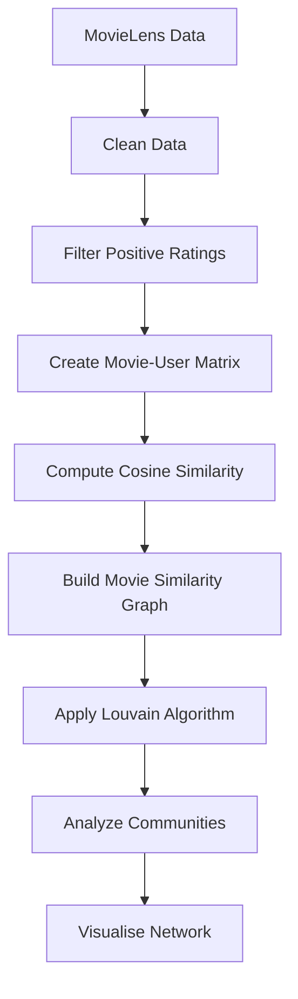

# 🎬 MovieLens Community Detection

A cute and data-driven exploration of how movies can be grouped into communities based on similar user-rating patterns using the Louvain algorithm.

This project aims to transform MovieLens rating data into a movie similarity network, detect communities of related films, and interpret the structure of those communities through graph analysis.

---

## 🌟 Project Idea

The core idea is simple and fun:

- each movie is treated as a node
- movies with similar user-rating patterns are connected
- the Louvain algorithm is used to detect communities
- the result is a network of movies that appear to belong together

This can help us understand patterns in audience taste and how movies relate to one another beyond just genre labels.

---

## 🎯 Research Questions

1. How can a movie similarity network be built from positive MovieLens ratings?
2. How many communities are found in the movie graph?
3. What is the size distribution of the detected communities?
4. How can movie communities be interpreted in terms of genre patterns and audience behavior?

---

## 📌 Objectives

- Prepare MovieLens ratings and movie metadata for analysis
- Build a movie-by-user representation from positive ratings
- Compute pairwise movie similarity using cosine similarity
- Construct a weighted network of movies
- Detect communities using the Louvain algorithm
- Summarize community membership, sizes, and characteristics
- Visualize the structure of the network and the resulting groups

---

## 📊 Dataset

This project uses MovieLens rating data and corresponding movie metadata.

Expected datasets include:

- Ratings data
  - userId
  - movieId
  - rating
  - timestamp
- Movie metadata
  - movieId
  - title
  - genres

The main analysis is based on positive ratings, such as ratings greater than or equal to 4.

---

## 🧠 Methodology

The planned workflow is:

1. Load the MovieLens datasets
2. Inspect the data for missing values and duplicates
3. Filter to positive ratings
4. Build a movie-user rating matrix
5. Compute cosine similarity between movies
6. Construct a weighted movie similarity graph
7. Apply Louvain community detection
8. Analyze community sizes and composition
9. Visualize the network and interpret the results



---

## 🕸️ Graph Structure

The intended graph model is:

- Node: Movie
- Edge: Similarity relationship between movies
- Weight: Cosine similarity score
- Community label: Detected movie cluster

This graph provides a structured way to study which movies tend to appear similar to users based on rating patterns.

---

## 📈 Louvain Algorithm

Louvain is a community detection method used to partition a graph into groups with stronger internal connections than external ones.

In this project, Louvain is used to:

- identify clusters of similar movies
- detect groups in the movie similarity network
- interpret underlying audience preference patterns

A higher modularity value generally suggests a clearer community structure within the network.

---

## 🧪 Example Analysis Flow

```python
# Example workflow idea
# 1. Load the datasets
# 2. Drop missing or duplicate records
# 3. Filter ratings >= 4
# 4. Build a movie-user matrix
# 5. Compute cosine similarity
# 6. Create a graph of similar movies
# 7. Run Louvain community detection
# 8. Summarize and interpret communities
```

This repository is intended to grow into a complete analysis project with implementation code, processed outputs, and visual results.

---

## 📁 Current Project Structure

At the moment, the repository is still in its early stage.

```text
MovieLens-Community-Detection/
├── .gitignore
├── README.md
└── future project files (scripts, notebooks, datasets, outputs, visualizations)
```

---

## 👥 Team Members

1. Ismatul Izza - 23031554226
2. Bernicca Olivia S - 23031554176
3. Aghasi Yanda W A - 23031554039
4. Berlianti Debby M - 23031554006

---

## 📝 Notes

This README documents the project concept and the intended workflow. As the project develops, more concrete implementation details, results, and visual outputs will be added.

The repository is expected to eventually include:

- data preparation scripts
- graph construction code
- Louvain analysis steps
- result summaries
- visualizations
- final interpretations and insights

---

## 🌈 Final Message

This project is all about discovering which movies naturally belong together in the eyes of users. In a way, it turns the movie catalog into a little social network — where similar films can gather in the same community.

The result is a more intuitive way to explore movie relationships, audience preferences, and hidden patterns in the data.

---

## 📎 Repository

- GitHub: [theresiashi/MovieLens-Community-Detection](https://github.com/theresiashi/MovieLens-Community-Detection)

