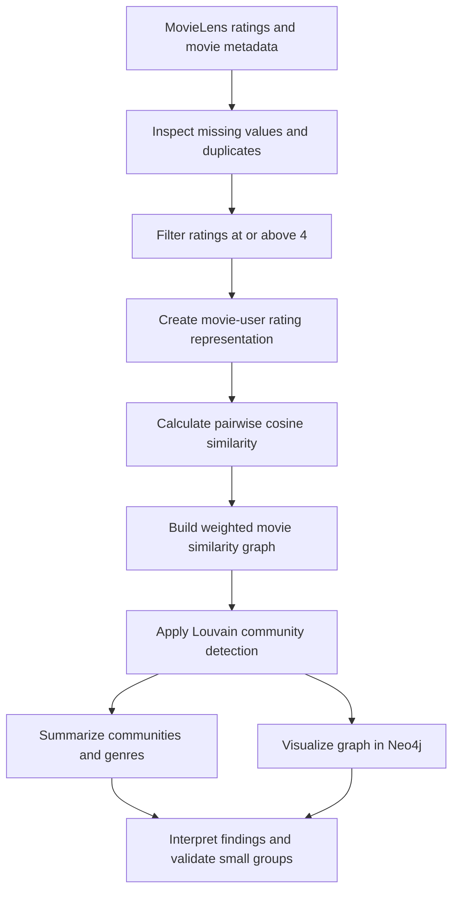
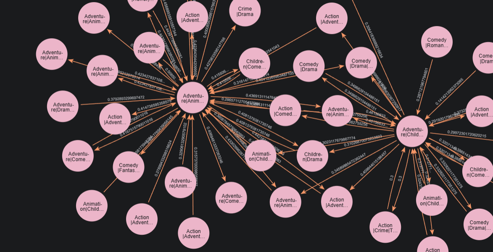

# Movie Community Detection Using the Louvain Algorithm on MovieLens Rating Data

> **Repository status:** This README documents the project concept and the analysis details supplied in the project brief. At the time this file was prepared, the repository contained only this README and a Python-oriented `.gitignore`; no source code, dataset documentation, query outputs, notebooks, results, or screenshots were available to verify the workflow or reported statistics. Values and methods marked **unverified** must be checked against the completed implementation before being treated as final results.

## 1. Project Title and Description

This project explores movie communities in MovieLens rating data. It is intended to build a weighted movie-similarity network from users' positive ratings and use Louvain community detection to find groups of movies that exhibit similar rating patterns. Neo4j is identified in the project description as the graph analysis and visualization environment; implementation details remain to be confirmed from project files.

## 2. Project Overview

The proposed analysis transforms user–movie ratings into pairwise movie similarities. Movies are modeled as graph nodes, and sufficiently similar pairs are represented by weighted relationships. A community detection algorithm then partitions the graph into groups whose internal connections are relatively dense compared with connections between groups.

The project brief proposes cosine similarity and Louvain community detection. Because this repository currently has no analysis code or result files, these should be understood as the stated project design, not independently verified implementation details.

## 3. Research Questions

1. How can a movie similarity network be constructed from positive MovieLens ratings?
2. How many communities are detected, and how are their sizes distributed?
3. How do modularity values and movie characteristics help explain the resulting communities?

## 4. Project Objectives

- Prepare rating and movie metadata for network analysis.
- Represent movies and their similarity relationships as a weighted graph.
- Identify communities of movies using the proposed Louvain method.
- Summarize community counts, sizes, member movies, and genre characteristics.
- Make the network and community structure interpretable through graph visualization.
- Assess whether small communities represent meaningful groups or potentially noisy results.

## 5. Dataset Description

The project brief identifies MovieLens ratings and movie metadata, including genres, as intended inputs. The exact MovieLens release, source URL, files, download procedure, and dataset dimensions are **not documented in the available repository**.

| Data component | Intended contents | Verification status |
| --- | --- | --- |
| Ratings | User identifiers, movie identifiers, and rating values | MovieLens is named in the brief; specific release and file are not provided |
| Movie metadata | Movie identifiers, titles, and genre labels | Described in the brief; actual metadata file is absent |

The planned preprocessing includes checking missing values, removing duplicate records, and selecting positive ratings of **4, 4.5, or 5** (equivalent to `rating >= 4`). The rating scale and exact handling of missing or duplicate values should be verified against the dataset and source code when added.

## 6. Methodology and Workflow

The following describes the proposed workflow based on the project brief. Specific implementation choices and parameters are not available for verification.

1. **Collect the data** — obtain MovieLens ratings and corresponding movie metadata and genres. Record the exact dataset release and source.
2. **Preprocess** — inspect missing values and duplicate records, then retain positive ratings using the stated `rating >= 4` criterion.
3. **Build movie representations** — derive a movie-by-user rating representation from the selected ratings. The repository does not yet document the exact matrix construction or treatment of unrated items.
4. **Calculate similarity** — calculate cosine similarity between movie representations. A high score indicates more similarly oriented rating vectors under the chosen representation; it does not by itself establish that two movies are alike in genre or content.
5. **Construct the graph** — create one node per movie and weighted similarity edges between qualifying movie pairs. The similarity cutoff, if any, is **not available** and is not assumed here.
6. **Detect communities** — apply Louvain community detection to optimize modularity and assign movies to communities. The implementation, parameters, and whether Louvain runs in Neo4j or another environment are **not documented**.
7. **Analyze results** — calculate the number of communities and their size distribution; inspect the largest and smallest groups, member titles, and genre composition. Report average size with its calculation and clarify whether isolated movies are included.
8. **Visualize and interpret** — use the intended Neo4j graph view (as stated in the brief) to inspect the network and community assignments, and relate visual patterns to quantitative summaries.



## 7. Graph Network Architecture

The intended graph model is:

| Graph element | Proposed representation | Notes |
| --- | --- | --- |
| Node | Movie | A movie node should be tied to a stable movie identifier; actual property names are not available. |
| Relationship | `SIMILAR_TO` | Proposed relationship name from the project brief; actual schema is not available for inspection. |
| Edge weight | Cosine similarity | Proposed weight meaning; property name, numeric range, and storage format are undocumented. |
| Community assignment | Movie community identifier | Intended analysis output; property name and persistence approach are unknown. |

No similarity threshold is reported because its value cannot be verified from repository files. The graph schema and any Cypher import or analysis queries should be added once the actual implementation is available.

## 8. Louvain Algorithm and Modularity

Louvain is a graph community detection approach that heuristically seeks partitions with high modularity. Modularity compares the observed density of connections within communities with the density expected under a chosen null model. In this weighted network, the interpretation also depends on how similarity weights are defined and used by the implementation.

A higher modularity value can indicate that the proposed partition has stronger within-community structure relative to that baseline. It is not a measure of recommendation accuracy, nor proof that movies in a group share a narrative or genre. Comparisons are meaningful only when graph construction and algorithm settings are known and held appropriately consistent.

The project brief mentions a modularity value of **0.781**, but the repository contains no query output or code to verify it. It is therefore recorded as an unverified, brief-reported figure below—not as a confirmed result.

## 9. Tools and Technologies

The available repository files do not establish which analysis libraries or software were actually used. The repository description and project brief mention Neo4j; the brief proposes Python-oriented analysis and Cypher/Neo4j graph work. No dependency manifest, source code, or configuration is present to confirm these tools or any specific libraries.

| Technology | Status in available files |
| --- | --- |
| Neo4j | Named in repository description and project brief; implementation is not present to verify. |
| Python | A Python `.gitignore` template is present, but that alone does not confirm Python source code or dependencies. |
| Cypher | No Cypher files or queries are present. |
| Pandas, NumPy, scikit-learn, NetworkX | Not verified; no dependency or source files available. |

Do not treat this list as a confirmed runtime stack until source files and dependency declarations are added.

## 10. Results and Key Findings

The figures below were supplied in the project brief, but cannot be verified from the current repository. In particular, the community count is inconsistent in the brief. No figure is presented as a validated repository result.

| Metric | Brief-reported value | Status |
| --- | ---: | --- |
| Movie nodes | 9,742 | Unverified; no graph export or query output |
| Similarity relationships | 251,600 | Unverified; no graph export or query output |
| Modularity | 0.781 | Unverified; no algorithm output or settings |
| Communities | 3,481 **and** 4,381 | Conflicting values in the brief; requires validation |
| Largest community | 377 movies | Unverified; no membership output |
| Average community size | Approximately 2.23, conditional on 4,381 communities | Not independently verified; depends on the community count and inclusion of all 9,742 nodes |

The project brief states that most detected communities contain approximately **1–5 movies**. This observation also requires validation against the actual community-size distribution. Once results are available, report the exact count or percentage of communities in that range and specify how isolated nodes are treated.

## 11. Community Analysis and Visualization

For an interpretable analysis, report the community-size distribution (including singleton groups), the largest community and its member movies, and the most common genres within communities. A genre summary can help describe a cluster, but genre overlap should not be assumed to explain the cluster: the proposed edges arise from rating-pattern similarity.

**Visualization placeholder:** AThe following figure illustrates the movie similarity network generated using Neo4j and the Louvain community detection algorithm.



*Project Documentation*

For a detailed explanation of the project methodology, implementation, and findings, please refer to the presentation document below.

[View Project Presentation (PDF)](pitch_desk_movie_leans.pdf)

The referenced image files do not currently exist in the repository. Add them before replacing these placeholders with rendered images.

## 12. Business and Practical Implications

If validated, groups of movies with similar user-rating patterns may provide a useful exploratory view of audience preference. Such communities could help analysts inspect patterns, organize a catalog, or inform candidate generation for a recommendation feature. They should not be treated as recommendations on their own: the analysis would need user-centered evaluation and comparison with suitable baselines before making claims about relevance or business impact.

## 13. Limitations

- The repository currently has no analysis implementation, dataset, results, or visualization assets, so the described workflow and brief-reported statistics are not independently reproducible.
- The MovieLens release, rating scale, data transformations, and missing/duplicate handling are unspecified.
- The movie-user representation, similarity threshold, and rules for constructing edges are undocumented.
- Louvain implementation and parameters are unspecified; community assignments can depend on graph construction and algorithm settings.
- The community-count discrepancy (3,481 versus 4,381) must be resolved from authoritative output.
- Very small communities may reflect sparse data, threshold effects, or noise; they need validation before substantive interpretation.
- Similarity of rating patterns does not establish similarity of plot, genre, quality, or causal preference.
- No recommendation-system evaluation or user-impact analysis is present.

## 14. Future Improvements

- Add a reproducible data preparation and analysis pipeline, with dataset source and version documented.
- Validate small communities and assess sensitivity to sparsity, similarity cutoffs, and other graph construction choices.
- Analyze relationships between movie genres and community structure without equating correlation with explanation.
- Compare Louvain results with Leiden using consistently constructed graphs and clearly reported settings.
- Explore integration of community information into a movie recommendation system.
- Evaluate any recommendation system with suitable offline metrics, baselines, and—where feasible—user-centered evaluation.
- Publish machine-readable result tables, algorithm settings, graph schema, and visualization assets.

## 15. Project Structure

The repository currently contains only the following tracked files:

```text
.
├── .gitignore
└── README.md
```

No scripts, notebooks, data, output files, or screenshots were present at the time this README was prepared. Update this tree as the project implementation is committed.


## 16. Team Members

Team member names :
1. Ismatul Izza 23031554226
2. Bernicca Olivia S 23031554176
3. Aghasi Yanda W A 23031554039
4. Berlianti Debby M 23031554006

## 18. Author and Credits

- **Repository:** [theresiashi/MovieLens-Community-Detection](https://github.com/theresiashi/MovieLens-Community-Detection)
- **Project description:** “Project Analisis Komunitas Film Menggunakan Neo4j dan Louvain”
- **Dataset credit:** MovieLens is named in the project brief; the exact dataset release and citation are not yet documented. Add the precise source and required citation when confirmed.
- **Author/team:** Not specified in the available project files.
